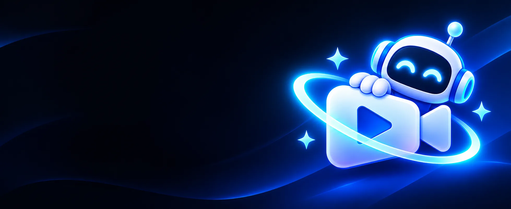

# HyperForge



Aplikasi Windows untuk memproduksi video pendek dan video edukasi (Shorts, TikTok, Reels, YouTube) bersama Claude:
dari ide, riset, naskah, suara narasi, storyboard, sampai MP4 jadi. Repo ini bernama **ANIMA** (nama lama aplikasi);
aplikasinya sekarang bernama **HyperForge**.

- **Tampilan:** React + shadcn/ui di dalam Electron (aplikasi Windows, bukan web).
- **Data & login:** Supabase (gratis), data tiap akun terpisah berkat RLS.
- **Otak:** Claude Code milik pengguna (langganan Pro/Max) atau API custom yang kompatibel Anthropic (**Otak AI**).
- **Render:** di laptop pengguna. Render 3D/2D lewat Remotion; style lain lewat skill Claude yang merender dari kode.
- **Suara:** vibi.pro (ElevenLabs / MiniMax / CapCut), dua suara A dan B, timing per kata untuk subtitle.

Target minimum: laptop 4 core / 8 thread, RAM 16 GB. Aplikasinya sendiri memakai sekitar 270 MB RAM.

## Style video

| Style | Cara kerja |
| --- | --- |
| Kartun 3D | Remotion + three.js (template `remotion-template/`) |
| Komik 2D | Remotion, latar & tokoh SVG digambar Claude |
| HyperForge Studio, Explainer Datar (tokoh Tora) | Skill `studio-skill/hyperforge-studio` + `edu-skill/edu-motion-studio` |
| Kamal (gelap / terang) | Skill `kamal-skill/kamal` |
| Animate, Bang Motion | Skill pihak ketiga, disertakan utuh |
| Lemo-Opuscar, Motionmaxxing, Stickman | Skill pihak ketiga, dipasang dari GitHub pada commit tetap |
| Google Flow (Veo) | Naskah Claude + klip dari Google Flow yang dioperasikan Claude (lihat **Keamanan**) |
| Animantra: Vector | Paket berbayar milik pengguna sendiri; **tidak** disertakan di repo atau installer |

Fitur lain: storyboard & naskah yang bisa diedit sebelum render, branding kanal, thumbnail + judul hook, riset
internet (Agent Reach), pustaka video, dan pemeriksaan hasil render (layar hitam, gambar diam, suara).

---

## 1. Menjalankan dari kode

```powershell
npm install
npm run build      # tsc + vite
npm start
npm run dev        # mode pengembangan (tampilan berubah otomatis)
npm test           # tes otomatis
npm run dist       # installer lokal di release/ (tanpa mengunggah)
```

## 2. Menyiapkan Supabase (sekali saja, sekitar 5 menit)

1. Daftar di <https://supabase.com>, **New project**, region **Singapore**.
2. **SQL Editor > New query**, tempel seluruh isi `supabase/schema.sql`, klik **Run**.
3. **Project Settings > API**: salin **Project URL** dan **publishable (anon) key**.
4. Buka HyperForge, tempel keduanya di layar pertama, lalu **Daftar**.
   Konfirmasi email bisa dimatikan di **Authentication > Sign In / Providers > Email > Confirm email**.

### Membatasi pendaftaran (kode undangan)

URL dan publishable key ada di `app-defaults.json` (ikut installer dan repo publik). Itu aman untuk data (RLS), tetapi
siapa pun bisa mendaftar dan memakai kuota gratis project. Untuk menutupnya:

1. Jalankan `supabase/migrations/005_kode_undangan.sql` di SQL Editor (sudah termasuk di `schema.sql`).
2. Buat kode: `insert into public.invite_codes (code, note, max_uses) values ('TEMAN-2026', 'grup teman', 10);`
3. Bagikan kodenya ke teman. Selama tabel kode kosong, pendaftaran tetap terbuka.

Pantau juga jumlah pengguna di dasbor Supabase (**Authentication > Users**) dan pemakaian di **Reports**.

## 3. Proyek Remotion (render 3D/2D)

**Pengaturan > Proyek Remotion > Siapkan otomatis** membuat `%USERPROFILE%\anima-remotion` dari
`remotion-template/` (sekitar 600 MB). Versi Remotion dikunci di 4.0.539; `@react-three/postprocessing` dikunci di 3.0.4
(versi 3.2.x membuat frame kosong). Sisakan minimal 5 GB kosong di drive TEMP.

## 4. Suara (vibi.pro)

Isi API key di **Pengaturan > Suara & audio**. Key disimpan **terenkripsi** (Windows DPAPI) di
`%APPDATA%\ANIMA Studio\settings.json` dan hanya bisa dibuka akun Windows yang sama. Setiap pembuatan suara memakai
kredit vibi.pro; Claude menyebut jumlah kreditnya dulu.

## 5. Menyambungkan Claude

**Pengaturan > Integrasi Claude > Sambungkan** mendaftarkan server MCP `anima` ke Claude Code / Claude Desktop.
Password tidak disimpan; yang disimpan hanya token sesi MCP di `%APPDATA%\ANIMA Studio\mcp-session.json`.

| Tool MCP | Fungsi |
| --- | --- |
| `anima_list_projects` / `anima_get_project` | Daftar project / ambil brief |
| `anima_save_story` / `anima_patch_shot` | Simpan naskah + shot / revisi satu shot |
| `anima_job_status` | Status render terakhir |
| `anima_vibi_tts` / `anima_vibi_words` | Suara vibi.pro + timing per kata (dipakai sesi skill) |

## 6. Membagikan ke teman

Kirim `release/HyperForge-Setup-x.y.z.exe` (atau link Releases). Teman:

1. Install **Node.js LTS** dan **Claude Code** (lalu login).
2. Jalankan installer HyperForge, **Daftar** dengan email sendiri (dan kode undangan kalau kamu memakainya).
3. **Pengaturan > Skill video > Siapkan otomatis** untuk style yang dipakai, dan **Proyek Remotion > Siapkan otomatis**
   untuk render 3D/2D.
4. Opsional: API key vibi.pro sendiri, **Sambungkan** Claude.

Windows SmartScreen bisa memperingatkan karena installer belum ditandatangani (lihat **Keamanan**).

`app-defaults.json` hanya boleh berisi URL dan **publishable** key Supabase. Jangan pernah menaruh secret key
Supabase atau API key vibi.pro di sana.

## 7. Merilis update

Update dikirim lewat GitHub Releases `kamssser/ANIMA`. Aplikasi mengecek saat dibuka dan setiap 4 jam, mengunduh di
latar belakang, lalu meminta pengguna menekan **Restart & update** (tidak dipasang diam-diam).

1. Naikkan `version` di `package.json`.
2. Tulis catatan di `CHANGELOG.md` (`## x.y.z - YYYY-MM-DD`), wajib.
3. `npm run build` dan `npm test` harus lolos (GitHub Actions juga menjalankannya di setiap push).
4. Commit + push, lalu `npm run release` (butuh env `GH_TOKEN`).

Memperbaiki catatan rilis yang sudah terbit: `node scripts/release.mjs --notes-only`.

**Nama repo:** `build.publish` di `package.json` menentukan dari mana aplikasi mengambil update. Kalau repo diganti nama,
ubah `build.publish[0].repo` juga; `npm run release` menolak jalan kalau berbeda dengan `git remote origin`.

## Keamanan

- **Izin perintah Claude dibatasi.** Sesi skill hanya boleh menjalankan `node`, `python`, `ffmpeg`, perintah berkas
  dasar, dan skrip milik skill. `bash`, `sh`, `curl`, dan `npm` bebas tidak diizinkan.
- **Riset terpisah dari produksi.** Riset internet (WebSearch, WebFetch, Agent Reach) dikerjakan di tahap
  **Generate dengan Claude**, yang tidak bisa menjalankan perintah. Sesi skill tidak membaca web kecuali pengguna
  menyalakannya di **Pengaturan > Riset internet** (ada peringatannya). Ini mencegah teks jahat di sebuah halaman web
  menyuruh Claude menjalankan perintah di laptop (prompt injection).
- **Google Flow adalah pilihan sadar.** Ketentuan Google umumnya melarang akses otomatis, jadi akun bisa dibatasi.
  Pengguna harus menyetujui risikonya dulu. Chrome Flow memakai profil terpisah, port kendali acak di `127.0.0.1`,
  dan ditutup lewat tombol **Tutup Chrome Flow** atau otomatis saat HyperForge ditutup.
- **API key terenkripsi** (vibi.pro, Otak AI) dengan Windows DPAPI.
- **Update:** installer belum ditandatangani. Siapa pun yang memegang akun GitHub atau `GH_TOKEN` pemilik bisa
  mengirim update ke semua pengguna. Wajib: 2FA di akun GitHub, `GH_TOKEN` fine-grained khusus repo ini dengan masa
  berlaku pendek (`npm run release` memperingatkan kalau tidak). Rencana jangka panjang: tanda tangan kode (mis. Azure
  Trusted Signing), yang juga menghilangkan peringatan SmartScreen.
- Jendela aplikasi memakai `contextIsolation`, `sandbox`, `nodeIntegration: false`; link luar hanya http/https.

## Lisensi

Kode HyperForge: [MIT](LICENSE).

**Remotion** (render 3D/2D) **bukan** MIT: gratis untuk perorangan dan tim sampai 3 orang; perusahaan/organisasi
yang lebih besar wajib membeli lisensi perusahaan. Karena installer HyperForge dibagikan, setiap pengguna yang
merender lewat Remotion tunduk pada <https://www.remotion.dev/license>.

### Pihak ketiga

Disertakan di repo (lisensi masing-masing ada di foldernya):

| Bagian | Sumber | Lisensi |
| --- | --- | --- |
| `animate-skill/animate` | [cth9191/animate](https://github.com/cth9191/animate) | MIT |
| `bang-motion-skill/bang-motion` | [bangtutorial/bang-motion](https://github.com/bangtutorial/bang-motion) | MIT |
| `remotion-template/` (dasar) | [mromidev/claude-animated-shorts](https://github.com/mromidev/claude-animated-shorts) | MIT |
| `kamal-skill/kamal/kit/fonts` | Plus Jakarta Sans | SIL OFL 1.1 |
| `edu-skill/edu-motion-studio` | milik pemilik HyperForge | boleh dibagikan bersama HyperForge |

Dipasang dari GitHub pada commit tetap lewat **Siapkan otomatis** (tidak ada di repo, tidak diubah):

| Skill / alat | Sumber | Lisensi |
| --- | --- | --- |
| `lemo-opuscar` | [lemomo-ai/lemo-opuscar](https://github.com/lemomo-ai/lemo-opuscar) | MIT; contoh film CC BY 4.0 |
| `motionmaxxing` | [Tejashmakwana/motionmaxxing](https://github.com/Tejashmakwana/motionmaxxing) | Apache-2.0 |
| `google-flow-browser-mcp` | [TMSSS05/google-flow-browser-mcp](https://github.com/TMSSS05/google-flow-browser-mcp) | MIT |
| `@playwright/mcp` | Microsoft | Apache-2.0 |
| `directing-stickman-videos` | [kaomei/stickman-video-director](https://github.com/kaomei/stickman-video-director) | MIT |
| `hand-drawn-video-prompts` | [kaomei/hand-drawn-video-prompts](https://github.com/kaomei/hand-drawn-video-prompts) | MIT |
| `human-voice` | [zircote/human-voice](https://github.com/zircote/human-voice) | MIT |
| Agent Reach | [Panniantong/agent-reach](https://github.com/Panniantong/agent-reach) (rilis GitHub, bukan PyPI) | MIT |

**Animantra: Vector** adalah paket berbayar; lisensinya melarang dibagikan ulang. HyperForge hanya memakai skill yang
dipasang pengguna sendiri di `~/.claude/skills/animantra-vector`.

## Pindah ke laptop lain

1. Install **Git**, **Node.js LTS**, **Python 3**, dan **Claude Code**.
2. `git clone https://github.com/kamssser/ANIMA.git`, `cd ANIMA`, `npm install`.
3. `setx GH_TOKEN "github_pat_..."` (token baru per laptop, masa berlaku pendek).
4. Buka Claude Code di folder ini; `CLAUDE.md` berisi aturan rilis.
5. Di aplikasi: Siapkan otomatis (Remotion + skill), isi lagi API key vibi.pro (key terenkripsi tidak bisa dipindah
   antar laptop), **Sambungkan** Claude.

Data project, shot, dan riwayat render ada di Supabase, jadi tinggal login.

## Struktur folder

```
electron/           proses utama: jendela, render, update, skill, MCP
  settings.cjs        pengaturan (API key terenkripsi lewat shared/secret.cjs)
  skills.cjs          mesin style skill + izin perintah Claude
  skillchat.cjs       panel obrolan Claude di aplikasi
  flow-chrome.cjs     Chrome khusus Google Flow (port acak, persetujuan risiko)
  paths.cjs           lokasi berkas yang dibaca proses luar (app.asar.unpacked)
src/                tampilan React + shadcn/ui
shared/             data bersama aplikasi + MCP (jenis konten, style, enkripsi)
mcp/                server MCP untuk Claude
supabase/           schema.sql + migrasi
remotion-template/  proyek Remotion (disalin oleh Siapkan otomatis)
*-skill/            skill Claude yang disertakan
scripts/            rilis, daftar asarUnpack untuk MCP
tests/              tes otomatis (node --test)
docs/               gambar README
```
